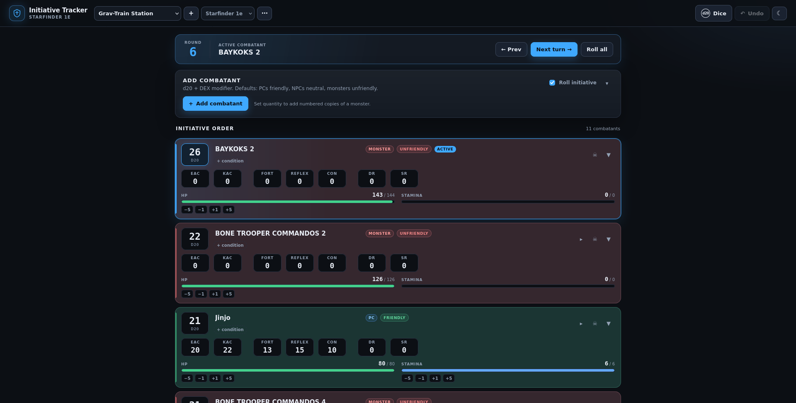

# Initiative Tracker

A local, single-page initiative and HP tracker for tabletop sessions. Everything runs in the
browser and is saved to `localStorage` — no accounts, backend, or network calls.

Built for **D&D 5e**, **Starfinder 1e**, **Starfinder 2e / Pathfinder 2e**, **Shadowrun 5e / 6e**,
**Battletech**, and a flexible **generic** system.



## Features
**This is still work in progress!**

- Add PCs, monsters, and NPCs one at a time or in numbered groups (`Goblin 1`–`Goblin 4`).
- Tag each combatant as **Friendly**, **Neutral**, or **Unfriendly**. Monsters default to unfriendly,
  NPCs to neutral, and PCs to friendly. Friendly cards get a light green tint, neutral cards a light
  gray tint, and unfriendly cards a light red tint. Clicking the tag cycles through the three values.
- Roll initiative automatically or enter a manual score, then reroll individuals or the whole table.
- Per-system trackers:
  - **D&D 5e** — HP, temporary HP, death saves, conditions, Armor Class (AC), and saving throw
    modifiers for Str, Dex, Con, Int, Wis, and Cha.
  - **Starfinder 1e** — Stamina absorbs damage before HP, plus Resolve Points, EAC, KAC, DR, SR, saving throws, and monster HP regeneration.
  - **Starfinder 2e / PF2e** — HP, Fort/Reflex/Con saving throw modifiers, and PF2e-style
    conditions.
  - **Shadowrun** — separate Physical and Stun monitors with initiative passes.
  - **Battletech** — armor before structure, heat, pilot hits, and side-based activation.
  - **Generic** — HP plus one extra resource pool.
- Condition chips with optional round durations that tick down at the end of each round.
- Mark a combatant dead with the **☠** button on their card. Dead combatants move to a **Dead**
  list at the end of the page, are skipped by the turn order, and can be revived or removed there.
  In Battletech the same list holds destroyed units.
- Dice roller with expressions (`2d6+3`, `4d6`, `d20-1`), quick dice, advantage/disadvantage,
  and a rolling log.
- Multiple saved encounters with rename, duplicate, delete, and per-encounter system presets.
- JSON export of a single encounter or a full backup, and JSON import with normalization of
  missing or malformed fields.
- Snapshot undo history (up to 60 steps per encounter), dark/light themes, and keyboard shortcuts.
- Responsive layout for desktop, tablet, and phone widths.

## Getting started

Requires Node.js 20.19+ (or 22.12+) and npm.

```bash
npm install
npm run dev
```

Open <http://localhost:5173>. The dev server uses a fixed port so saved data stays on the same
origin.

To use the tracker from another device on the same network, open the **Network** URL printed by
Vite (for example `http://192.168.1.25:5173`). The server listens on all local interfaces; if the
page does not load, allow Node.js through your firewall on port `5173`.

### Production build

```bash
npm run build     # type-check and bundle to dist/
npm run preview   # serve the built app on http://localhost:4173
```

The preview server is also reachable on your local network at its printed **Network** URL
(port `4173`).

`npm start` runs both the build and the preview server.

### Tests

```bash
npm test          # run the Vitest suite once
npm run test:watch
```

## How it works

### Initiative

- **d20 systems** — initiative is `d20 + modifier`; ties break on the tiebreak value, then name.
- **Shadowrun** — initiative is `Reaction + Intuition + 1d6`. After a combatant acts, their score
  drops by 10 and the remaining combatants act in the new order. When no positive scores remain,
  the round advances and everyone rerolls initiative.
- **Battletech** — each side rolls 2d6. Sides alternate activations, starting with the winner.
  Click **Activate** on a unit to mark it as acted and pass to the next side. When the activation
  order is exhausted, the round advances, conditions tick, and sides reroll.

### Damage

- D&D and generic systems subtract damage from temporary HP first, then current HP.
- Starfinder 1e drains Stamina before HP.
- Battletech strips armor before internal structure; zero structure marks the unit destroyed.
- Shadowrun's Physical and Stun monitors are adjusted independently with the field on each track.

Use the `±` field beside a track to change it: type a negative number (e.g. `-5`) to damage or a
positive number (e.g. `5`) to heal, then press **Enter**. Expand a card to apply a custom amount,
edit notes, set temporary HP/Resolve, adjust heat and pilot hits, and add conditions.

### Saved data and moving between browsers

Data is stored under the `initiative-tracker:v1` key in the current browser and origin. Clearing
site data, using a different browser, or opening the app on a different port starts a fresh
library.

To move or back up your encounters, open the encounter menu (**⋯**):

- **Export this encounter** downloads a single-encounter JSON file.
- **Export full backup** downloads every encounter.
- **Import JSON…** accepts either file type. Imported encounters always get new internal IDs and
  are added alongside your existing encounters.

### Keyboard shortcuts

| Key | Action |
| --- | --- |
| `N` | Next turn / next side |
| `P` | Previous turn (d20 systems) |
| `A` | Focus the add-combatant name field |
| `D` | Open the dice roller |
| `Esc` | Close the dice roller / leave the current field |
| `Ctrl`/`Cmd` + `Z` | Undo the last change (when not typing) |

## Project layout

```
src/
  components/    UI: header, turn bar, cards, tracks, dice panel
  data/          System presets and condition lists
  lib/           Initiative, HP, Battletech, dice, factories and normalization
  state/         Store (undo, toasts) and localStorage/import/export
tests/           Vitest unit tests
```

## Notes

- The app is entirely client-side; there is no player-facing second screen in this version.
- Undo history is per encounter and is not persisted across reloads.
- The imported JSON is normalized defensively, so hand-edited or older files load with sensible
  defaults.
